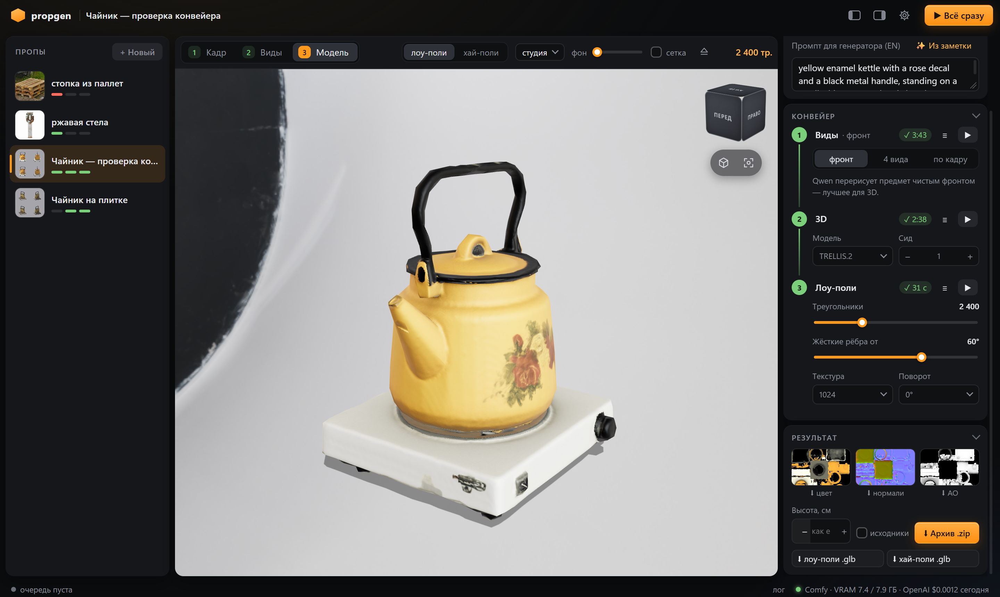
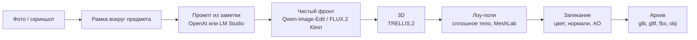

# propgen

Генератор игровых пропов из фотографий: фото предмета → чистый фронтальный вид → 3D-модель → лоу-поли модель
в духе Half-Life 2 (1–3 тыс. треугольников, текстура цвета, normal map, AO), упакованная для Unity, Unreal, Godot
и Blender. Всё считается локально на одной видеокарте NVIDIA от 8 ГБ.




## Быстрый старт

```bat
:: 1. Запустите ComfyUI (Desktop, portable или git-установку).
setup.cmd     :: виртуальное окружение, зависимости, проверка системы
start.cmd     :: сервер и браузер: http://127.0.0.1:8795
```

Если системе чего-то не хватает, при запуске откроется окно **Настройки** с результатами проверки и кнопками
загрузки моделей. Сквозная проверка установки: `.venv\Scripts\python tools\smoke.py` — пример из `examples/`
проходит весь конвейер и выводит время каждого шага.

Установку можно поручить Claude Code: в репозитории есть скилл `propgen-setup` (`.claude/skills/propgen-setup`),
который находит ComfyUI, устанавливает недостающую ноду и модели и проверяет результат прогоном.

## Конвейер



| Шаг | Реализация | Время (RTX 5060, 8 ГБ) |
|---|---|---|
| Промпт | Перевод заметки на английский целиком и дополнение видимыми деталями: gpt-4.1-mini или Gemma-3-4B в LM Studio | ~2 с (OpenAI, ~$0.0003) · ~10 с локально |
| Фронт | Qwen-Image-Edit-2511 Q4 GGUF + Lightning, 4 шага, 768 px — точнее по форме и надписям; FLUX.2 Klein 4B — быстрее, но свободнее с деталями | Qwen ~70 с · Klein ~10 с |
| Фронт «по тексту» | Текстовая модель описывает предмет по кадру, генератор рисует его с нуля: FLUX.2 Klein 4B или Krea-2 Turbo (если она уже есть в ComfyUI) | Klein ~10 с |
| 3D | TRELLIS.2 (int8) или Pixal3D; режим «4 вида» — Pixal3D multiview | ~3 мин |
| Лоу-поли | Вокселизация → поле расстояний → marching cubes → квадрик-декимация MeshLab → Smart UV → запекание в Cycles | ~20 с |
| Экспорт | Blender: glb, gltf + bin, fbx, obj + mtl; текстуры по схеме Poly Haven | ~5 с |

Первая генерация после запуска ComfyUI дольше (~3,5 мин для Qwen) — модели читаются с диска.

## Интерфейс

- **Кадр.** Рамка с ручками и направляющими, сохраняется автоматически. Запуск без рамки требует подтверждения.
  Фото добавляются перетаскиванием или вставкой из буфера обмена (`Ctrl+V`).
- **Виды.** Режимы: чистый фронт, четыре вида, работа прямо по кадру и «по тексту» — для простых предметов (паллеты,
  ящики, бочки): фото только описывается словами, а предмет рисуется с нуля, без грязи и перспективы снимка. Для фронта выбирается движок (Qwen или Klein)
  и обработка износа (сохранить или убрать). Каждый вид можно перегенерировать, заменить своим фото или открыть
  в полноэкранном просмотре.
- **Модель.** Просмотр лоу- и хай-поли, сетка, навигационный куб, HDRI-окружение. Просмотрщик выгружается из
  видеопамяти на время генерации.
- **Конвейер.** У каждого шага — статус, время, лог, запуск/остановка и собственные параметры: бюджет треугольников,
  порог жёстких рёбер, разрешение текстуры, поворот.
- **Строка состояния.** Текущая нода ComfyUI, шаг выборки, занятая видеопамять, расход OpenAI за день; предупреждение,
  если ComfyUI перестал присылать события.
- **Экспорт.** Архив с моделью в четырёх форматах, реальной высотой в сантиметрах и, по выбору, исходными материалами.
- **Обновление.** Когда в репозитории появляются новые коммиты, в заголовке окна появляется плашка «Обновление · N»
  со списком изменений и кнопкой «Обновить и перезапустить» (`git pull` и перезапуск сервера).

### Структура архива

```
<имя>/
├── <имя>.glb
├── <имя>.gltf, <имя>.bin
├── <имя>.fbx
├── <имя>.obj, <имя>.mtl
├── textures/
│   ├── <имя>_diff_1k.png      цвет с запечённым затенением
│   ├── <имя>_nor_gl_1k.png    нормали OpenGL (Blender, Unity, Godot)
│   ├── <имя>_nor_dx_1k.png    нормали DirectX (Unreal, Source)
│   └── <имя>_ao_1k.png
├── preview.png
├── info.json                  треугольники, размеры, промпт, параметры
├── README.txt
└── source/                    по выбору: хай-поли, фото, кадр, фронт
```

Единица — метр, ось Y вверх (glTF), начало координат — в центре основания модели.

## Требования

| Компонент | Требование |
|---|---|
| Система | Windows; NVIDIA от 8 ГБ видеопамяти (12–16 ГБ заметно быстрее); 32 ГБ RAM; ~40 ГБ на диске под модели |
| [ComfyUI](https://www.comfy.org/) | Актуальная версия (TRELLIS.2 и 3D-ноды входят в ядро) и нода [ComfyUI-GGUF](https://github.com/city96/ComfyUI-GGUF) |
| [Blender](https://www.blender.org/download/) | 4.2 или новее; путь определяется автоматически |
| Python | 3.10–3.12 (для 3.13+ нет сборок pymeshlab) |
| Тексты | Ключ OpenAI, либо [LM Studio](https://lmstudio.ai) с локальной моделью, либо заметки на английском без модели |

Модели (~32 ГБ основной набор, ~4,4 ГБ для Klein) загружаются из окна настроек или командой
`.venv\Scripts\python tools\doctor.py download --group core` в каталоги, которые использует сам ComfyUI.
Krea-2 Turbo для режима «по тексту» — необязательная группа `krea` (~12 ГБ): GGUF Q4_K_M из
[vantagewithai/Krea-2-Turbo-GGUF](https://huggingface.co/vantagewithai/Krea-2-Turbo-GGUF) и энкодер из
[Comfy-Org/Krea-2](https://huggingface.co/Comfy-Org/Krea-2). Если в ComfyUI уже лежат другие её веса (fp8, nvfp4, int8,
другие кванты GGUF) — используются они, ничего не скачивается.

## Диагностика

| Симптом | Причина и решение |
|---|---|
| Генерация вида идёт десятки минут, загрузка GPU 100% при низком энергопотреблении | ComfyUI вытеснен в общую память Windows другими приложениями. Перезапустите ComfyUI и не запускайте параллельно ресурсоёмкие GPU-задачи. Профилактика: панель NVIDIA → параметры программы для python.exe ComfyUI → «CUDA — политика резервной системной памяти» → «Предпочитать отсутствие» |
| Ошибки в проверке системы | Окно «Настройки» указывает, что именно исправить |
| Шаг завершился ошибкой | Лог шага (кнопка ≡) или `work/props/<id>/logs/<шаг>.log` |
| ComfyUI не отвечает | ComfyUI Desktop по умолчанию слушает порт 8000, portable и git — 8188; проверка подскажет рабочий адрес |

## Структура проекта

| Путь | Назначение |
|---|---|
| `server.py` | FastAPI: пропы, очередь задач (по одной — видеокарта одна), настройки, проверка, экспорт, обновление |
| `web/` | Интерфейс без сборки: `app.js`, `controls.js`, `index.html`, `style.css`; three.js с CDN; HDRI в `hdri/` |
| `tools/views.py` | Фронт и развороты (Qwen-Image-Edit, FLUX.2 Klein) |
| `tools/mesh.py` | 3D (TRELLIS.2, Pixal3D) |
| `tools/lowpoly.py`, `tools/solidify.py` | Лоу-поли и запекание (Blender + MeshLab) |
| `tools/export.py`, `tools/pack.py` | Экспорт в форматы и архив |
| `tools/llm_openai.py`, `tools/llm.py` | Промпт через OpenAI или LM Studio |
| `tools/config.py`, `tools/doctor.py` | Настройки (`config.json`), проверка системы и загрузка моделей |
| `tools/comfywatch.py`, `tools/smoke.py` | Прогресс ComfyUI, сквозная проверка |
| `.claude/skills/propgen-setup/` | Инструкция по установке для агента; `CLAUDE.md` — памятка для работы с кодом |

<details>
<summary>Почему лоу-поли строится через сплошное тело</summary>

Сетка TRELLIS/Pixal3D после `RemeshMesh` — тонкая двойная оболочка с отверстиями, внутренними полостями и большим
числом шумовых туннелей. На такой сетке стандартная декимация не работает: `DecimateMesh` в ComfyUI схлопывает форму,
Decimate в Blender оставляет вырожденные треугольники, MeshLab с сохранением топологии останавливается на ~4 тыс.
треугольников, а без него стенки прорастают друг в друга.

`solidify.py` строит сплошное тело: вокселизация оболочки → заливка недостижимого снаружи объёма (и горизонтальных
срезов — для предметов без дна) → поле «расстояние до исходной сетки минус t» → marching cubes → одна замкнутая
поверхность → квадрик-декимация. Нормали и AO запекаются с этого гладкого тела, цвет — с хай-поли: исходная сетка
генератора несёт артефакты воксельной решётки, которые в normal map превращаются в рябь.
</details>
