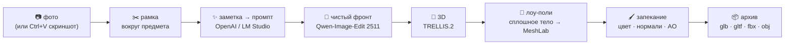

<div align="center">

# 🫖 propgen

**Фото предмета → игровой проп в духе Half-Life 2. Локально, на одной видеокарте.**

Сфоткал чайник на даче → через ~5 минут у тебя лоу-поли модель на 1–3 тысячи треугольников
с текстурой, normal map и AO, упакованная для Unity, Unreal, Godot или Blender.


</div>

---

## ⚡ Быстрый старт

```bat
:: 1. запусти ComfyUI (Desktop, portable — неважно)
setup.cmd     :: venv + зависимости + проверка системы
start.cmd     :: http://127.0.0.1:8795 — откроется сам
```

Чего-то не хватает — сразу откроются **⚙ Настройки** с чеклистом системы и кнопками «Скачать» для моделей.
Проверить, что всё едет целиком: `.venv\Scripts\python tools\smoke.py` (чайник из `examples/` проходит весь конвейер).

> 🤖 **Лень разбираться?** Открой папку в Claude Code и скажи «установи propgen» — скилл `propgen-setup`
> сам найдёт ComfyUI, доставит ноду и модели, проверит прогоном.

## 🧪 Как это работает



| Шаг | Чем | Время на RTX 5060 8 ГБ |
|---|---|---|
| ✨ Промпт | заметка по-русски → полный перевод + детали с кадра (gpt-4.1-mini или Gemma-3-4B в LM Studio) | ~2 с · ~$0.0003 |
| 🎨 Фронт | Qwen-Image-Edit-2511 Q4 GGUF + Lightning, 4 шага, 768 px | ~70 с (первый после запуска ComfyUI ~3,5 мин) |
| 🧊 3D | TRELLIS.2 int8 (или Pixal3D) → хай-поли 150k, текстура 2048 | ~3 мин |
| 🔻 Лоу-поли | воксели → поле расстояний → marching cubes → квадрики MeshLab → Smart UV → Cycles bake | ~20 с |
| 📦 Архив | Blender-экспорт в 4 формата, текстуры по схеме Poly Haven | ~5 с |

## 🎮 Что умеет интерфейс

- **Пропы слева**, рабочая область по центру (вкладки **Кадр · Виды · Модель**), инспектор справа — всё тянется и сворачивается (`Ctrl+B`, `Ctrl+Alt+B`).
- **Кадр**: рамка с ручками и направляющими, сохраняется сама. Без рамки запуск не пройдёт — интерфейс спросит.
- **Виды**: фронт · 4 вида · по кадру. Любой вид — ↻ перегенерировать, ⤒ заменить своим фото, клик — на весь экран с зумом.
- **Модель**: лоу-/хай-поли, сетка, ViewCube с ракурсами, HDRI-фон (студия, цех, закат, небо).
- **Конвейер-степпер**: у каждого шага статус, время, лог ≡, ▶ / ■ и свои настройки (бюджет треугольников, жёсткие рёбра, текстура, поворот).
- **Строка состояния**: что сейчас считает ComfyUI, шаг выборки, видеопамять, расход OpenAI за день. Если ComfyUI «залип» — горит ⚠.
- **📦 Архив .zip**: реальная высота в сантиметрах, по желанию — исходники (хай-поли, фото, кадр, фронт).

```
chaynik_na_plitke/
├── chaynik_na_plitke.glb          ← всё в одном файле
├── chaynik_na_plitke.gltf + .bin  ← glTF с внешними текстурами
├── chaynik_na_plitke.fbx          ← Unity, Unreal, Max, Maya
├── chaynik_na_plitke.obj + .mtl   ← всё остальное
├── textures/
│   ├── *_diff_1k.png              ← цвет (AO запечено, как в HL2)
│   ├── *_nor_gl_1k.png            ← нормали OpenGL (Blender, Unity, Godot)
│   ├── *_nor_dx_1k.png            ← нормали DirectX (Unreal, Source)
│   └── *_ao_1k.png
├── preview.png · info.json · README.txt
└── source/                        ← по желанию
```

## 🧰 Что нужно

| | |
|---|---|
| 🖥 Железо | Windows, **NVIDIA от 8 ГБ** (12–16 ГБ — заметно быстрее), RAM от 32 ГБ, ~35 ГБ на диске под модели |
| 🎨 [ComfyUI](https://www.comfy.org/) | свежий (TRELLIS.2 и 3D-ноды в ядре) + нода [ComfyUI-GGUF](https://github.com/city96/ComfyUI-GGUF) |
| 🔷 [Blender](https://www.blender.org/download/) | 4.2+ — ищется сам |
| 🐍 Python | 3.10–3.12 (у pymeshlab нет колёс для 3.13+) |
| ✨ Тексты | ключ OpenAI **или** бесплатный [LM Studio](https://lmstudio.ai) **или** выключить и писать заметки по-английски |

Модели (~32 ГБ основное) качаются из настроек или `tools\doctor.py download --group core` — прямо в папки, которые
назначил сам ComfyUI, где бы он ни стоял.

## 🩺 Если что-то не так

| Симптом | Что делать |
|---|---|
| ⚠ Вид генерируется десятки минут, GPU «100%» при ~40 Вт | ComfyUI вытеснило в «общую» память Windows. Перезапусти ComfyUI. Не держи рядом тяжёлое на видеокарте (видеозвонки, игры). Профилактика: панель NVIDIA → python.exe ComfyUI → «CUDA — политика резервной системной памяти» → «Предпочитать отсутствие» |
| ✗ в проверке системы | ⚙ Настройки — у каждой строки написано, что поправить |
| Шаг упал | ≡ у шага или `work/props/<id>/logs/<шаг>.log` |
| ComfyUI «не отвечает» | Desktop слушает порт **8000**, portable — **8188**; проверка сама подскажет, где нашла |

## 🗂 Устройство

```
server.py              FastAPI: пропы, очередь задач (видеокарта одна — шаги по одному), настройки, проверка, экспорт
web/                   интерфейс без сборки: app.js, controls.js (свои контролы форм), three.js с CDN, hdri/
tools/
├── views.py           фронт и развороты (Qwen-Image-Edit)        ┐
├── mesh.py            3D (TRELLIS.2 / Pixal3D)                   │ отдельные процессы,
├── lowpoly.py         лоу-поли и запекание (внутри Blender)      │ работают и сами —
├── solidify.py        сплошное тело + декимация (venv)           │ параметры в шапке
├── export.py · pack.py  форматы и архив                          ┘
├── llm_openai.py · llm.py   промпт: OpenAI / LM Studio
├── config.py          config.json: пути, адреса, ключ
├── doctor.py          проверка системы и докачка моделей
├── comfywatch.py      живой прогресс ComfyUI (websocket)
└── smoke.py           прогон целиком
.claude/skills/propgen-setup/   инструкция для агента по установке
```

<details>
<summary>🔬 Почему лоу-поли устроен так хитро</summary>

Сетка TRELLIS/Pixal3D после `RemeshMesh` — тонкая двойная оболочка с дырами, пузырями и сотнями шумовых туннелей.
На ней ломается всё: `DecimateMesh` в ComfyUI схлопывает форму до десятков треугольников, Decimate в Blender оставляет
иглы, MeshLab с сохранением топологии застревает на ~4k, без него стенки прорастают друг в друга.

Рабочий путь (`solidify.py`): воксели оболочки → заливка всего, что недостижимо снаружи (+ горизонтальные срезы —
закрывают предметы без дна) → поле «расстояние до исходной сетки минус t» (KD-дерево, точнее вокселя) → marching cubes →
одна замкнутая поверхность → квадрик-декимация.

Нормали и AO печём не с хай-поли генератора, а с этого гладкого тела: хай-поли несёт полосы воксельной решётки и дрожь
ремеша — в normal map это превращалось в «кашу» мелких граней. Цвет — с хай-поли.
</details>

<div align="center">

Сделано с ❤️ и чайником с дачи — нашим ответом чайнику из 3ds Max.

</div>
